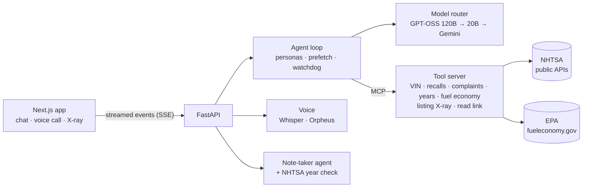

<p align="center">
  
</p>

<h1 align="center">VINsight</h1>

<p align="center">
  <strong>Know the car before you buy it.</strong><br />
  An AI copilot for first-time used-car buyers. It checks a car against federal safety data,
  catches scam listings, and backs every claim with a source you can open.
</p>


<p align="center"><sub>A real recording of the app, sped up. <a href="docs/demo.mp4">Watch as MP4</a></sub></p>

## What it does

Four modes share one conversation, so you can move from learning to shortlisting to checking a car
without repeating yourself.

| Mode | For when you… | What you get |
| --- | --- | --- |
| **Inspector** | found a car | Paste a VIN, a listing link or a PDF. A verdict (worth a look, caution or avoid) in one sentence, the recalls and complaint patterns that matter, checks for your mechanic, and questions for the seller. |
| **Scout** | don't know what to buy | A shortlist that fits your budget and life: the model years to avoid (from complaint data), EPA fuel economy and yearly fuel cost, and how cheap parts are to find. |
| **Coach** | have never done this | Plain-English guidance: the real monthly cost, title types, financing, inspections, common scams. |
| **Advisor** | would rather talk it through | A hands-free voice call with Sam. A car brief fills in as you talk, and every model he recommends is checked against NHTSA data. |

**It catches scams.** The Listing X-ray flags deposits before viewing, "I'm overseas, I'll ship it"
sellers, gift-card payments, salvage or flood titles and more, quoting the listing. It decodes the
VIN and compares it with the car being advertised: a 2015 Camry listing whose VIN belongs to a
2003 Accord is caught instantly.

## Engineering highlights

- **Every fact is verifiable.** Tool results carry source IDs (recall campaigns, complaint numbers,
  VINs). Answers cite them as footnotes, and the UI checks each citation against what the tools
  actually returned, flagging anything the model made up.
- **Agentic where it matters, deterministic where it doesn't.** The model decides what to look up
  and how to answer. Steps that never change (decode a VIN, then pull its recalls and complaints;
  X-ray an attached listing; the minimum verdict a salvage title forces) run in code. That made
  answers faster, cheaper and more reliable than letting a model plan them.
- **Tools are an MCP server.** Eight tools behind the Model Context Protocol (NHTSA, EPA, listing
  X-ray, link reader), usable from any MCP client, not just this app.
- **Model-agnostic, with live fallback.** GPT-OSS 120B on Groq by default, then GPT-OSS 20B, then
  Gemini. If a model fails mid-conversation, the history is replayed into the next one and the chat
  continues.
- **Built for a free tier's 8K tokens a minute.** Lean prompts and tool results (two dozen recalls
  reach the model in ~400 tokens), one tool call that researches a whole shortlist, and pacing that
  reads the provider's rate-limit headers and waits a few seconds when needed instead of failing
  over. Which models are out of quota is shared across every chat.
- **Streams everything.** Reasoning, tool steps with timings and the answer arrive live (first
  reasoning token in about 0.4 s on Groq), with a Stop button that cancels the work on the server.
- **A real-time voice agent without paid infrastructure.** Voice detection runs in the browser
  (AudioWorklet), Whisper transcribes, and replies are spoken sentence by sentence as they stream.
  You can interrupt; echo cancellation comes from routing speech through WebRTC. A second,
  smaller agent takes notes while code checks each recommendation against NHTSA and feeds problems
  back into the call.
- **Honest about its data.** NHTSA lists recalls per model, not per car, so VINsight never claims a
  recall is open or fixed; it tells you how to check.
- **Free to run.** One free Groq key powers everything, and visitors can bring their own keys.

## Architecture



## Built with

**Backend:** Python, FastAPI, a hand-written agent loop, MCP, Groq (GPT-OSS, Whisper, Orpheus),
Gemini · **Frontend:** Next.js, React, Tailwind CSS, Web Audio, WebRTC, Kokoro (in-browser voice) ·
**Data:** NHTSA vPIC, recalls and complaints APIs, EPA fuel economy · **Testing:** pytest (offline, recorded fixtures),
Playwright (demo)

## Roadmap

- [x] VIN decode, recalls, complaints, cited answers
- [x] Listing X-ray with a rule-based verdict
- [x] Scout, Coach, and the Advisor voice call
- [x] Streaming, model switching with fallback, bring-your-own keys
- [ ] Evals: citation validity, red-flag precision and recall, verdict accuracy on real listings
- [ ] Known-issues search over NHTSA complaint narratives (hybrid retrieval)
- [ ] Fair-price estimate from comparable listings

## Try it

```bash
cp .env.example .env    # add a free GROQ_API_KEY
cd backend && python3 -m venv .venv && .venv/bin/pip install -e ".[dev]" && .venv/bin/uvicorn vinsight.api:app --port 8000
cd frontend && pnpm install && pnpm dev    # http://localhost:3000
```

Configuration, the command-line tool, tests and recording the demo are in
[docs/DEVELOPMENT.md](docs/DEVELOPMENT.md).
